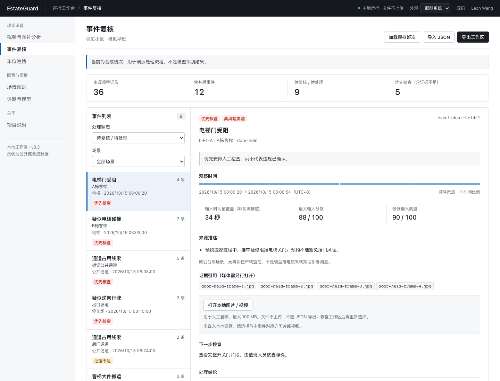

# EstateGuard · 社区智能巡检

**把监控线索变成能复核、能解释、能交接的物业事件。**

[在线体验（中文版）](https://leon1111-wgl.github.io/estateguard/) · [公开数据与训练](docs/PARKING_DATA.md) · [项目案例](docs/CASE_STUDY.md) · [模型卡](docs/MODEL_CARD.md) · [数据与接口](docs/DATA_CONTRACT.md) · [研究来源](docs/RESEARCH.md)



早班 08:00，住户搬运柜子进客梯，系统连续提醒；配送车辆停在通道旁，另一处摄像头画面太暗。物业人员需要知道：哪些提示属于同一件事、搬运是否有预约、哪些需要现场检查、交班时如何保留理由。

EstateGuard 将轻量视觉推理、场景规则、事件合并与人工复核串成一个可运行的 AI 应用。打开网页即可使用，不需要 API key 或付费服务。

## 已经能做什么

| 环节 | 可运行能力 |
| --- | --- |
| 公开数据车位巡检 | CNRPark 真实历史快照与 CNR-EXT 保留测试快照；三种占用模型可切换：DINOv2-small 线性探针（默认）、复用检测骨干的 MobileNetV2 迁移头、7,745 参数 MLP32 基线；逐时刻回放、全测试错例、人工结论恢复 |
| 风险控制与现场适配 | 温度校准后的三态分流（自动判空闲 / 自动判占用 / 送人工），阈值须用本摄像头跨天人工结论按“车位·日”检验；人工结论驱动的 L2-SP 少样本自适应，全部在浏览器本地计算 |
| 本地视觉推理 | 本站自托管两种检测器：默认 D-FINE-N（2024 实时检测 Transformer，ONNX Runtime Web），可切换回 SSDLite MobileNet V2；识别 COCO 80 类物体，显示检测框和分数。COCO val2017 测试半 AP 42.0 对 25.4 |
| 图片与短视频 | JPEG/PNG/WebP、MP4/WebM；每秒采样一帧，单次最多 20 秒，可选片段起点 |
| 场景规则 | 用户指定区域内车辆、持续停留、疑似逆向移动、支持类别的大件物品 |
| 事件处理 | 按摄像头、区域、匿名轨迹、类别合并；预约例外、高风险低分线索和证据不足分别处理 |
| 人工复核 | 查看本地媒体，确认或排除线索、补充证据、完成处置；保留草稿、理由与历史 |
| 交接与评测 | 检测 JSON、可恢复的工作区 JSON、中文交接单；事件级基线比较、标注冲突与视频划分泄漏检查 |

**现在包含两条真实推理链路：通用预训练检测器（D-FINE-N 默认，SSDLite 可选），以及车位占用分类（冻结视觉基础模型 + 本项目训练的线性头，另保留从零训练的小模型基线）。** 物体检测不等于违规识别。挡门动作、碰撞损伤、垃圾投放和精细大件分类尚无专用模型验证。八类事件都可以导入、复核；当前自动分析只覆盖上表的规则候选，不会自动认定损坏、身份或责任。

### 检测器升级（2026-10-19）

默认检测器从 2018 年的 SSDLite MobileNet V2 换成 D-FINE-N（官方 COCO 权重，本项目导出 ONNX，浏览器单线程运行）。在 COCO val2017 预先划分的测试半（2,500 张）上：

| 检测器 | AP | 小目标 AP | 物业相关 12 类平均 AP | 12 类召回 / 精确率 | 本机单张 P95 |
| --- | ---: | ---: | ---: | ---: | ---: |
| SSDLite（分数 ≥ 0.5） | 25.4 | 2.7 | 29.3 | 35.3% / 86.9% | 38 ms（WebGL） |
| **D-FINE-N**（分数 ≥ 0.6，开发半选定） | **42.0** | **22.6** | **44.5** | **54.6% / 86.8%** | 252 ms（单线程 WASM） |

召回提高明显，但床、餐桌、沙发、卡车等大件类别的精确率下降（例如餐桌 83.3% → 61.1%）；客梯规则用到的 6 类合并精确率 87.9% → 72.4%，误检 52 → 245，选该规则时页面会提示。上表为预先固定的原始结果；网页另加近重复框去重（评测后由找茬发现），复算 AP 41.3、12 类召回 / 精确率 54.4% / 87.1%。COCO 是通用照片，不代表小区监控画面。默认规则、逐类结果和失败项见[检测器协议](docs/validation/detector-upgrade-protocol.md)与[模型卡](docs/MODEL_CARD.md)。

## 先体验公开数据

打开[车位巡检](https://leon1111-wgl.github.io/estateguard/#parking)，点击「分析当前快照」。页面用公开图片像素运行模型，支持历史快照回放、原始标注对照、错例筛选、单车位图片上传与人工复核导出/恢复。布局沿用用户确认的中文业务工作台。占用只表示有车，不生成违停事件。

按「待人工复核」逐项核对，保存空闲或占用结论后退出待办；「无法判断」保留在待办并归入「需补证据」。「保存并继续」处理当前快照的下一项，进度仅统计已保存的人工结论。模型不确定项可单独筛选，不会替代人工完成状态。

交班前导出车位复核文件，下次恢复会回到原相机、快照、所选车位和模型，保留人工筛选与标注显示设置。模型结果筛选先回到「全部车位」，提示重新分析；旧文件缺少位置时明确说明。坏文件不会覆盖当前记录和草稿，成功恢复会停止回放。文件中的预测分数、自适应和阈值不直接恢复为可用模型结果。

在「评测与模型」中加载完整错例，可按「有车却报空闲」「空位却报占用」及摄像头/车位定位，导出带来源校验值的清单。选择样本会回到历史原图并重新运行模型；原图加载失败时可重试或记录需补证据，不能只凭分数确认空闲/占用。这帮助排查模型在什么位置失效，不会自动改正预测或提高准确率。

2026-10-17 起默认使用 **DINOv2-small 冻结特征 + 769 参数线性头**（ONNX Runtime Web，浏览器单线程）。在从未参与训练、选模或阈值选择的 **CNR-EXT 144,965 张**（同一停车场另外 9 个视角、23 天、晴/阴/雨）上：

| 模型 | EXT 平衡正确率 | EXT 有车报空闲 | 雨天平衡正确率 |
| --- | ---: | ---: | ---: |
| MLP32 基线 | 88.48% | 14.35% | 85.42% |
| MobileNetV2 迁移头 | 94.32% | 8.64% | 92.16% |
| **DINOv2 线性探针** | **95.88%** | **7.53%** | **94.19%** |

协议在评分前写定，默认模型在 EXT 评分前按已观察的 B 视角确定。仍有 7.53% 的实际占用被报空闲；EXT 与训练同一停车场，**不是新小区**。实测还发现，训练视角上校准的“错误 ≤ 1%”分流阈值在新视角失效（实际 6.02%），按单张快照计数的现场校准也会超标；网页因此对新摄像头默认全部送人工，现场阈值须按“车位·日”跨天检验；启用后约 10% 的车位·日随机抽检，证据足够时自动撤销阈值。EXT 按日期回放中它没有误撤销，但 3 个超标阈值只撤销了 1 个（评测段第 14 / 17 天，偏晚），残余错误仍超标。数据、结果和失败基线见[训练说明](docs/PARKING_DATA.md)与[预注册协议](docs/validation/parking-transfer-protocol.md)。

原 MLP32 基线：训练 4,284 张、验证 1,275 张，B 视角 6,413 张正确率 **76.84%**，平衡正确率 **77.39%**，1,134 张占用被错报为空闲。它保留为对照，全量错例和复现命令不变。没有把论文效果算作自己的结果。

## 体验原有检测与事件工作流

1. 打开网页，选择「使用公开示例图片」，或选择自己的本地文件。
2. 先运行「通用物体检测」，查看模型实际输出的框、类别和耗时；不知道拍摄时间时可以留空。
3. 选择场景规则，框选关注区域，填写来源与素材实际起始时间（UTC+8），核对后勾选确认，再次分析。
4. 把候选送入事件复核，查看原素材并记录判断理由。 替换证据时先检查新图片或视频首帧；文件损坏会保留原画面和草稿，并在附件旁提示原因。
5. 导出工作区和交接单；重新导入 JSON 可以恢复审查记录。

读取模拟班次期间可以继续复核。替换前会按当时的未导出记录和草稿确认，取消后保留记录与本地附件；较晚返回的旧读取不会覆盖已经导入、应用规则或送审的新工作区。加载与取消结果显示在原消息区。

复核内容改回已保存值（或未复核时的空值）后，可直接导出，无须重复保存或填写占位理由。草稿标记随实际修改更新；真正未保存的正文、结论变化仍须先处理，已保存但未导出的记录仍有离开保护。

换入新素材后，来源和时间清空，片段起点归零、关注区域恢复整幅。来自同一现场的下一份素材可点击「沿用上次现场设置」，再填写这份素材的时间并核对画面；原始尺寸不同时需要重新框选。失败替换会保留上一份素材、设置和已完成报告。现场设置只在当前标签页内存中保留，尚不支持具名预设或从检测报告恢复设置。

停留秒数、预期方向和片段起点按当前规则与素材类型启用，并标明用途。切换规则会保留输入草稿；通用检测不会被未使用的停车秒数阻止，切回停车规则后仍需填写有效值。检测报告只记录本次生效的参数。

默认的 D-FINE-N 首次检测读取约 28.4 MiB（模型与 WASM 运行库，与车位 DINOv2 共用运行库），SSDLite 约 19.1 MiB；车位巡检默认的 DINOv2 首次分析另需约 37.0 MiB（模型与 WASM 运行库），页面会先提示体积。页面显示实际读取进度、下载量与缓存复用量；可「取消加载」，保留素材和设置后重试。公共模型资源校验后缓存在本机，刷新可复用；缓存不可用时仍能运行。缓存不包含用户图片、视频或复核记录。

检测分数下限与重叠框合并规则已分开，避免提高分数时同一物体反而产生重复候选。检测 JSON 保存实际分数、重叠阈值、处理版本和采样设置；原版对照与失败用例见[验证记录](docs/VALIDATION.md)。这属于后处理修正，没有重新训练通用模型。

视频停车规则按稳定片段计时：车辆先驶入再停稳，也能形成待复核候选；驶入、驶离和两次独立停留不会凑成更长的停车时间。候选的时间、分数和证据只取对应稳定段，送审与交接保持分段。公开 CC0 图片生成的合成短片已通过真实模型回归；这验证规则流程，不代表真实违停识别准确率。

示例校车图片来自 Wikimedia Commons，作者 Raysonho，CC0。它用于检查模型是否运行，**不是违规样本**。模拟班次是另一套明确标注的合成数据。

## 本地运行

Python 3.10+、Node.js 22+。运行应用不需要 npm 安装，模型资产已包含在仓库中。

```bash
git clone https://github.com/leon1111-wgl/estateguard.git
cd estateguard
python3 -m http.server 8766 --directory web
# 浏览器打开 http://localhost:8766
```

```bash
node --test tests/*.test.mjs
python3 -m unittest discover -s tests -p 'test_*.py'
python3 scripts/verify_assets.py
python3 scripts/verify_parking.py
python3 scripts/verify_parking_transfer.py
python3 scripts/verify_detector_eval.py
node scripts/evaluate.mjs
python3 scripts/audit_annotations.py data/annotations-example.json
```

标注审计退出码：`0` 无发现，`1` 存在需检查的问题，`2` 文件或输入结构错误。分歧不会自动投票改成“真值”。

浏览器检查为可选开发依赖：安装 Playwright 及 Chromium 后运行 `node scripts/browser-check.cjs`、`node scripts/model-check.cjs`、`node scripts/parking-check.cjs`、`node scripts/parking-transfer-check.cjs`、`node scripts/detector-check.cjs`。已有 Chrome 可通过 `CHROME_PATH` 指定；运行前启动本地服务。详见[验证记录](docs/VALIDATION.md)。

## 效果如何理解

固定合成班次含 36 条观察、9 个参考事件。相同分数门槛的逐条告警有 33 个条目；加入合并、预约/时间规则和高风险不确定性保留后，待办变为 9 个。其中匹配 8 个参考事件，仍有 1 个错误提示、1 个没有观察记录的漏检。

这是**流程回归结果**，不是视觉模型准确率，不代表节省了 72.7% 人工时间。完整匹配规则、原始输出和剩余错误见 [web/benchmark.json](web/benchmark.json) 与[案例](docs/CASE_STUDY.md)。真实模型推理的运行记录单独报告，不混用这套数字。

## 数据与隐私

素材、模型推理和复核状态在当前浏览器标签页处理；无后端、账户、分析埋点或素材上传。下载模型时会访问本站。关闭标签页前须导出；图片/视频不随工作区保存。没有接入真实监控，也没有人脸或身份识别。

本项目受原有社区安全监控经历启发，独立实现。未公开原单位视频、标注或模型；履历中的 150 小时、1 万张等规模不作为本项目已拥有的数据。编码器微调、知识蒸馏、量化对比需要以后独立实验，当前不作已完成声明；车位模型只训练了线性头，DINOv2 使用社区发布的 int8 版本。

## 持续迭代

每轮由独立审查代理扮演物业值班员、住户或部署工程师，先复现痛点，再改代码并验证。另设界面设计师，在用户已经认可并固定的飞书式版面内，审查新增功能、桌面与手机适配和操作顺序，不再反复重新设计。问题、取舍和证据记录在 [IMPROVEMENT_LOG](docs/IMPROVEMENT_LOG.md)，下一步在 [BACKLOG](docs/BACKLOG.md)。自动迭代由本地 Codex 定时任务执行，仓库本身不包含自主执行的在线代理。

**作者：Leon Wang。** 第一版为中文，英文版在工作流成熟后增加。原创代码为 MIT；模型/运行库和示例素材按 [THIRD_PARTY_NOTICES](THIRD_PARTY_NOTICES.md) 中各自许可证分发。
